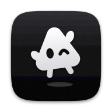

<div align="center">



# cald

</div>

Painel pessoal para controlar pelo celular as sessões do Claude Code que rodam no PC. O PC executa tudo; o celular é o controle remoto, acessado pela rede Tailscale.

Estado atual: backend e frontend funcionando; o PWA é React + Vite + shadcn/ui.

## Instalar na sua máquina

O PC fica ligado com o servidor rodando como serviço, e o celular acessa pela sua rede Tailscale. Não há nuvem no meio: só aparelhos da sua tailnet chegam ao painel, e um PIN opcional protege do celular desbloqueado na mão de outra pessoa (ver [PIN](#pin)). A exceção são as notificações, que passam criptografadas pelo serviço de push do Google (ou da Apple, no iPhone).

### Requisitos

- **Linux com systemd.** O servidor roda como serviço de usuário, e o quadro do computador lê CPU e memória de `/proc`.
- **Node.js 22.18 ou mais novo.** O servidor roda o TypeScript direto, sem etapa de build (testado no 26).
- **pnpm:** `npm install -g pnpm`.
- **Claude Code** instalado e logado: rode `claude` uma vez e faça o login. O painel usa as mesmas credenciais e o mesmo histórico de `~/.claude`.
- **Tailscale** no PC e no celular, logados na mesma conta.

### Jeito rápido: o instalador

Com os requisitos acima prontos (e o Tailscale com **MagicDNS** e **HTTPS Certificates** ligados no [painel de DNS](https://login.tailscale.com/admin/dns)):

```sh
git clone https://github.com/valb-mig/cald.git ~/Projects/cald
cd ~/Projects/cald
./deploy/install.sh
```

O script compila o app, sobe o serviço systemd (ajustando o caminho, o shell e o Node à sua máquina), publica na tailnet com `tailscale serve` e instala o comando `cald`. No fim, ele imprime o **link de acesso remoto** que o celular vai abrir. Depois, de qualquer terminal:

```sh
cald -link      # mostra o link de acesso remoto da tailnet
cald -pin       # define (ou troca) o PIN pedido ao abrir o painel; `cald -pin off` remove
```

O instalador é idempotente, então pode rodar de novo sem medo. Se preferir entender cada etapa, siga os passos manuais abaixo.

### 1. Baixar e compilar

```sh
git clone https://github.com/valb-mig/cald.git ~/Projects/cald
cd ~/Projects/cald
pnpm install
pnpm build        # gera web/dist, o app que o servidor entrega ao celular
```

O serviço do passo 3 espera o projeto em `~/Projects/cald`. Se clonar em outro lugar, ajuste o `WorkingDirectory` dele.

### 2. Testar à mão

```sh
pnpm --filter server start
curl http://127.0.0.1:7337/api/health      # em outro terminal: deve responder {"ok":true,...}
```

Abrir http://127.0.0.1:7337 no navegador do PC já mostra o painel. Pare com Ctrl+C.

### 3. Deixar rodando como serviço

O arquivo [`deploy/cald.service`](deploy/cald.service) sobe o servidor pelo shell interativo (`zsh -lic`) para herdar o PATH e as variáveis do seu `~/.zshrc`. Assim, o Claude aberto pelo celular enxerga as mesmas ferramentas do terminal (git, node, java…). Antes de instalar, confira o `ExecStart`:

- usa **bash** em vez de zsh? Troque `/usr/bin/zsh -lic` por `/bin/bash -lic`;
- o Node veio do nvm, fnm, mise ou asdf? Troque `/usr/bin/node` só por `node`, que o shell encontra no PATH.

```sh
systemctl --user link ~/Projects/cald/deploy/cald.service
systemctl --user enable --now cald
loginctl enable-linger "$USER"             # sobe no boot, mesmo sem login no PC
systemctl --user status cald
```

Se editar o arquivo depois de instalado, rode `systemctl --user daemon-reload` e reinicie o serviço.

### 4. Publicar na sua tailnet

No [painel de DNS do Tailscale](https://login.tailscale.com/admin/dns), deixe ligados **MagicDNS** e **HTTPS Certificates**. Depois, no PC:

```sh
tailscale serve --bg 7337      # se der "access denied": sudo tailscale set --operator="$USER"
tailscale serve status         # mostra o endereço, algo como https://seu-pc.tail1234.ts.net
```

A configuração do `--bg` sobrevive a reinícios. O servidor só escuta em `127.0.0.1`; o `tailscale serve` é a única porta de entrada, com HTTPS e só para a sua tailnet.

### 5. Instalar no celular

1. Com o Tailscale ligado no celular, abra no Chrome o endereço do passo 4.
2. No menu ⋮, toque em **Instalar app** (ou **Adicionar à tela inicial**). No iPhone, pelo Safari: **Compartilhar → Adicionar à Tela de Início**.
3. Abra o app instalado e, no painel **Computador**, toque em **Ativar notificações** e permita. Toque em **Enviar teste** para conferir.

O painel passa a abrir como um app e avisa quando o Claude precisa de você.

### Quem pode acessar

O servidor confere o login do Tailscale de quem acessa (o `tailscale serve` informa no cabeçalho `Tailscale-User-Login`). Por padrão, só entra o dono do PC na tailnet. Para liberar outra conta, use `ALLOWED_LOGINS`: ela substitui o padrão, então inclua o seu login também.

### PIN

O Tailscale garante que só aparelhos seus chegam ao painel, mas não protege do celular desbloqueado na mão de outra pessoa. Para isso, defina um PIN de 4 a 8 dígitos no PC:

```sh
cald -pin       # pede o PIN duas vezes, sem mostrar
cald -pin off   # remove
```

Vale na hora, sem reiniciar o serviço. Daí em diante, o app abre numa tela de bloqueio, no celular e no navegador do PC (o acesso local também pede). Quem confere é o servidor: só o hash do PIN fica no PC (`~/.local/state/cald/pin.json`), e acertar dá um token que toda chamada da API e o WebSocket precisam levar, então abrir a API direto, sem o app, também esbarra no PIN. Depois de 5 erros seguidos, o servidor faz esperar 30 s, e a espera dobra a cada erro até 15 min. Trocar o PIN derruba todos os aparelhos destravados.

O app trava sozinho depois de 5 min sem uso ou no fundo. Em **Computador → Sobre → Segurança** dá para mudar o tempo (1, 5, 15 ou 30 min, ou **Ao sair**, que trava assim que o app vai para o fundo), desligar o travamento automático ou **Travar agora**. Esses ajustes valem para o aparelho. Fechar o app também trava; recarregar a página não.

Com várias máquinas, rode `cald -pin` em cada uma com o mesmo PIN: você digita uma vez e o app destrava todas. Uma máquina com PIN diferente fica sem conexão no app até você acertar o dela.

### Várias máquinas

Instale o cald em outra máquina sua da mesma tailnet (o mesmo login do Tailscale) e ela aparece sozinha no app, em até um minuto: cada servidor pergunta ao Tailscale quais máquinas do dono respondem como cald. Não há central: o app, instalado a partir de qualquer uma, fala direto com todas, e cada servidor aceita o app vindo de outra máquina sua (só do mesmo dono, nunca de outro endereço). Com uma máquina desligada, as outras seguem funcionando.

As notificações passam pela máquina de onde o app foi instalado: o celular só se inscreve nela, e as outras repassam os avisos para ela. Com ela desligada, os avisos das outras não chegam.

### Configuração

| Variável | Padrão | Para quê |
|---|---|---|
| `PORT` | `7337` | Porta local; o `tailscale serve` precisa apontar para ela |
| `PROJECT_ROOTS` | `~/Projects` | Pastas onde o celular pode abrir projetos, separadas por `:` (pasta nova de projeto vai na primeira; outras pastas podem ser adicionadas pela tela de Projetos) |
| `ALLOWED_LOGINS` | o dono do PC | Logins do Tailscale com acesso, separados por `,` |
| `EXTRA_ORIGINS` | (nenhuma) | Origens extras aceitas do navegador, separadas por `,` |
| `UPLOADS_DIR` | `~/.cache/cald/uploads` | Onde ficam os anexos enviados pelo celular |
| `CLAUDE_CONFIG_DIR` | `~/.claude` | Configuração e histórico do Claude Code, se você usa outra pasta |
| `MACHINE_NAME` | o nome do sistema | Nome desta máquina no app, quando há várias |
| `WHISPER_CLI` | `~/.local/share/cald/whisper/whisper.cpp/build/bin/whisper-cli` | Binário do Whisper para o ditado no Firefox (ver [Ditado no Firefox](#ditado-no-firefox-whisper)) |
| `WHISPER_MODEL` | `~/.local/share/cald/whisper/models/ggml-small-q5_1.bin` | Modelo do Whisper |
| `PIPER_BIN` | `~/.local/share/cald/piper/piper/piper` | Binário do Piper para a leitura em voz alta no PC (ver [Voz natural no PC](#voz-natural-no-pc-piper)) |
| `PIPER_VOICE` | `~/.local/share/cald/piper/voices/pt_BR-faber-medium.onnx` | Voz do Piper, com o `.onnx.json` ao lado |
| `ACTIVITY_FILE` | `~/.local/share/cald/activity.json` | Resumo do uso por dia, para o Início (sobrevive à limpeza dos registros pelo Claude Code) |
| `WAKATIME_CLI` | `~/.wakatime/wakatime-cli` | Binário do WakaTime, para o seu tempo no painel contar lá (ver [WakaTime](#wakatime)); `WAKATIME=0` desliga |
| `WAKATIME_GOAL_HOURS` | `4` | Quantas horas de hoje enchem a medida do WakaTime no PC |
| `EXTRA_MACHINES` | (nenhuma) | Outras máquinas além das achadas no Tailscale (ex.: uma instância de teste, `http://127.0.0.1:7338`), separadas por `,` |

No serviço, defina com `systemctl --user edit cald` e depois `systemctl --user restart cald`:

```ini
[Service]
Environment=PROJECT_ROOTS=%h/Projects:%h/code
```

### Ditado no Firefox (Whisper)

O ditado do Chrome e do celular usa o reconhecimento de voz do navegador, e o Firefox não tem. Para ditar pelo Firefox, instale o Whisper no PC, que transcreve ali mesmo, sem internet e sem o áudio sair do PC:

```sh
deploy/install-whisper.sh        # compila o whisper.cpp e baixa o modelo small-q5_1 (~190 MB)
```

Precisa de git, cmake e um compilador de C++. O servidor acha o Whisper sozinho, sem reiniciar, e o microfone passa a aparecer no Firefox. O modelo `small-q5_1` vai bem em português e usa uns 400 MB de memória só enquanto transcreve. Com mais memória sobrando, o `large-v3-turbo-q5_0` acerta mais (`deploy/install-whisper.sh large-v3-turbo-q5_0` e `WHISPER_MODEL` apontando para ele).

### Voz natural no PC (Piper)

O **Ouvir** usa a voz do aparelho. No celular ela é boa, mas no PC com Linux o navegador fala pelo speech-dispatcher, que vem com o espeak: robótico e difícil de entender. Para ouvir no PC com uma voz natural, instale o Piper, que gera a fala ali mesmo, sem internet:

```sh
deploy/install-piper.sh          # baixa o Piper e a voz pt_BR-faber-medium (~90 MB)
```

O servidor acha o Piper sozinho, sem reiniciar; recarregue a página no PC. Cada frase é gerada no PC enquanto a anterior toca, então só a primeira demora um instante. O celular segue com a voz dele. Se o Piper falhar no meio de uma leitura, ela continua com a voz do navegador. Há outras vozes em português (`cadu-medium`, `jeff-medium`, `edresson-low`): `deploy/install-piper.sh cadu-medium` e `PIPER_VOICE` apontando para ela.

### WakaTime

Se você usa [WakaTime](https://wakatime.com), o tempo com o Claude pelo painel conta lá, no projeto certo.

São dois lados. O que o **Claude faz** já vem do próprio `wakatime-cli`, que lê os transcritos das conversas (`wakatime-cli --sync-ai-activity`) e manda como *AI Coding*; quem dispara isso costuma ser o plugin do editor, então, com o editor fechado, vale deixar um timer do systemd rodando a cada poucos minutos:

```ini
# ~/.config/systemd/user/wakatime-ai-sync.service
[Service]
Type=oneshot
ExecStart=%h/.wakatime/wakatime-cli --sync-ai-activity
Nice=10
```

```ini
# ~/.config/systemd/user/wakatime-ai-sync.timer
[Timer]
OnBootSec=2min
OnUnitActiveSec=5min

[Install]
WantedBy=timers.target
```

Depois: `systemctl --user enable --now wakatime-ai-sync.timer`.

O outro lado é o **seu**: ler a resposta, conferir um diff, escrever a próxima mensagem. Nada disso vira transcrito, e por isso o servidor manda os heartbeats dele mesmo, com as regras dos plugins de editor (um por arquivo a cada dois minutos, no máximo): abrir um arquivo no explorador ou ver um diff conta como *code reviewing*, e o tempo mexendo numa conversa conta no projeto dela. Parou de mexer ou saiu do app, para de contar.

Com isso em pé, o PC ganha a medida **Hoje**, acima da de CPU (no pé da lista de conversas ou, com ela recolhida, na alça): quanto você já codou hoje (o que o Claude fez mais o seu tempo), pelo mesmo número que o `wakatime-cli --today` mostra. Ele enche até a meta de `WAKATIME_GOAL_HOURS` e fica verde ao bater.

Sem o `wakatime-cli` instalado, nada disso acontece: a medida não aparece e o painel segue igual. Para desligar com ele instalado, use `WAKATIME=0`.

### Problemas comuns

- **A página não abre no celular:** confira se o Tailscale está ligado nos dois aparelhos e se `tailscale serve status` aponta para a porta 7337.
- **Erro `tailnet_identity_required`:** o celular está em outra conta do Tailscale; ponha os dois logins em `ALLOWED_LOGINS`.
- **Erro `host_not_allowed`:** acesse pelo nome `https://….ts.net`, não pelo IP.
- **Pelo celular, o Claude não acha ferramentas que existem no terminal:** o serviço não carregou o seu shell. Revise o `ExecStart` (passo 3).
- **Logo depois de ligar o PC, só o acesso local funciona:** o serviço pode subir antes do Tailscale; ele tenta de novo a cada 15 s.
- **As notificações não chegam:** use **Enviar teste** no painel Computador. Se aparecer erro, ele vem do serviço de push; se não der erro e nada chegar, libere as notificações do app e tire o Chrome da otimização de bateria nas configurações do Android. Falhas de envio aparecem nos logs como `falha ao enviar notificação`.
- **Qualquer outra coisa:** `journalctl --user -u cald -f` mostra os logs.

### Atualizar

```sh
cd ~/Projects/cald
git pull
pnpm install
pnpm build
systemctl --user restart cald
```

Vindo de antes da troca de nome (quando o projeto se chamava claude-remote): rode `./deploy/install.sh` de novo. Ele desliga o serviço `claude-remote`, sobe o `cald` e troca o comando `cr` por `cald`. As pastas de dados (`~/.local/share/claude-remote` e as outras) mudam de nome sozinhas na primeira subida e ficam como atalho para as novas.

Ou pelo celular, no painel **Computador**, cartão **Atualização do PC**: ele mostra as novidades da `main` do GitHub, e **Atualizar e reiniciar** faz os passos acima (trocando para a `main`, se o PC estiver noutra branch). A atualização recusa se o repositório no PC tiver mudanças não commitadas, se a `main` do PC tiver commits que não estão no GitHub ou se alguma conversa do painel estiver trabalhando ou esperando resposta. O painel fica fora do ar por alguns segundos, e as conversas que estavam abertas nele são reabertas sozinhas, com o mesmo modelo e modo.

Com o app aberto no celular, aparece o aviso **Versão nova do app**: toque em **Atualizar**. Ao voltar para o app, ele procura sozinho a versão nova.

## Usar pelo celular

O que dá para fazer:
- **Início:** o app abre aqui (no PC, ao lado da lista de conversas, quando nenhuma está aberta). Uma saudação com a data e, numa linha, o que está acontecendo (quantas conversas pedem você, quantas trabalham, quanto do limite de 5 h foi usado). Abaixo:
  - **Pedindo você / Agora**: aprovações e perguntas de todas as conversas do painel, com os mesmos cartões do chat para responder ali mesmo; as abertas no PC que esperam você levam até elas; e as que estão trabalhando ou com algo em segundo plano.
  - **Limites do plano** (5 h, semana e por modelo) com previsão pelo ritmo desde o começo da janela: até onde vai ou, se for acabar antes de renovar, quando (em laranja). Embaixo, CPU, memória e processos do Claude no PC.
  - **Dias com o cald**: o ano em quadradinhos, como o grid de contribuições do GitHub, com a cor mais forte nos dias com mais sessões pelo cald (**Tudo** conta também as do terminal e do VSCode). Mostra os dias de uso, a sequência atual e o recorde; tocar num dia mostra as sessões, as mensagens e o custo.
  - **Últimos 30 dias**: custo estimado, mensagens suas, dias de uso e tokens; o custo de cada dia em colunas; um mapa de calor dos dias da semana e horários em que você mais usa; e os projetos que mais consumiram. O custo é a preço de tabela da API.
  - **Projetos recentes**: branch e arquivos não commitados de cada um, a última conversa, quanto custou em 30 dias e **+** para começar uma conversa nova nele.
  - O histórico vem dos registros das conversas no PC, que o Claude Code apaga depois de ~30 dias; por isso o servidor guarda um resumo por dia em `~/.local/share/cald/activity.json`, e o grid não perde os dias antigos. Dias de antes dos registros que ainda existem vêm do histórico de mensagens do terminal (`~/.claude/history.jsonl`), sem custo.
- **Salinha** (`/salinha`; o atalho fica no painel Computador): um prédio de escritórios desenhado em SVG para deixar de fundo e acompanhar tudo de uma vez. Cada conversa aberta (no painel ou no PC) é uma área do escritório, separada das outras por divisórias; cada andar tem áreas dos dois lados do corredor (no celular, uma por andar, com o corredor à esquerda), e conversa nova ganha área nova, no lugar onde fica até fechar.
  - **Estações:** o claudinho da conversa (o mesmo do avatar dela, com o nome dele) e os funcionários (os subagentes, cada um com um claudinho sorteado) chegam pelo elevador e vão até a estação do que estão fazendo: mesa com o PC (web, inclusive `curl`), gaveteiro (lendo e procurando arquivos, inclusive `cat`, `grep` e afins no terminal, e compactando a conversa), bancada (editando), terminal (comandos), quadro (planejando e coordenando), café (pensando) e sofá (descansando, com a TV ligada quando algo roda em segundo plano); quem pede você sai até o corredor com um "!". A última ferramenta segura o claudinho na estação por alguns segundos, porque Read e Edit acabam antes da salinha perguntar, e cada um fica um tempo mínimo onde chegou antes de ir para outra.
  - **O que acontece na conversa vira animação:** cada arquivo editado é uma folha voando para a pilha da bancada; erro solta fumaça e um "!?"; teste acende o semáforo do rack, verde ou vermelho; `git commit` faz o claudinho levar uma caixa ao elevador, e `git push` ou `gh pr create` chama o caminhão de entregas na rua; skill tira um livro da estante; o quadro mostra as tarefas da conversa (TodoWrite) com a barra de progresso; o subagente que termina entrega uma pasta ao claudinho da conversa antes de ir embora; turno encerrado ou pedido respondido ganham um ✓. O claudinho da conversa usa o chapéu do modelo: coroa no Opus, chapéu de mago no Fable, boina no Sonnet e brotinho no Haiku.
  - **Vida própria:** os claudinhos piscam, olham para a tela, digitam em rajadas e andam de lá para cá pensando. Parado, cada um descansa de um jeito e troca de tempos em tempos: cochila na cadeira com a cabeça caída, senta no sofá (que cabe dois), olha a cidade pela janela, rega a planta, pega um livro na estante, vai ao café, ao bebedouro do corredor ou ao quadro, se espreguiça — e, com dois na mesma área, os dois se encontram no meio da sala para conversar. Ninguém ocupa o mesmo canto que o outro. A área que pede você pulsa em âmbar (e a salinha rola até ela), a que descansa à noite apaga a luz, e com o limite de 5 h estourado o escritório fecha, com "VOLTA ÀS…" no letreiro.
  - **Cidade:** o céu segue o relógio aos poucos, com o sol e a lua cruzando, nuvens, avião, pássaros e, de vez em quando, chuva. Na rua, carros, vans e ônibus passam nas duas mãos, de faróis acesos à noite e guardando distância de quem vai à frente, e gente anda na calçada, de guarda-chuva quando chove. Tudo na escala dos claudinhos: quem passa na calçada tem a altura de um deles, e um carro, umas duas vezes e meia isso de comprimento. No Halloween aparecem abóboras e morcegos, na festa junina, bandeirinhas, e no Natal, luzinhas no telhado.
  - **Toques:** tocar num claudinho mostra o que ele faz (e ele pula); tocar na área abre a conversa ou, se ela pede você no painel, os pedidos ali mesmo, para aprovar sem sair. Para as conversas abertas no PC, o servidor lê o fim do registro delas (só de novo quando ele muda). No topo, dá para manter a tela acesa e abrir em tela cheia; `/salinha?demo` mostra um escritório de mentira, cheio, e `?hora=21` e `?chuva` mudam o céu para ver como fica.
- **Conversas:** no topo, um quadro com CPU, memória e os limites do plano do Claude (janela de 5 h e semana, com horário de reset). Abaixo, as conversas, nesta ordem: as que precisam de você, as fixadas, as abertas agora e as recentes. A aba mostra um contador das que precisam de você. Segurar o dedo numa conversa (ou clicar com o botão direito, no PC) abre o menu dela com **Apagar conversa**, que pede confirmação; a aberta no PC não pode ser apagada até ser fechada lá.
- **Nova** (nas Conversas) pergunta só onde trabalhar, sem projeto (`~`) ou um projeto, e abre um chat vazio. A primeira mensagem, digitada na própria caixa do chat com modelo, modo, `/`, `@` e anexos, cria a sessão.
- **Worktrees:** com outra conversa já aberta no projeto (no painel ou no PC), a conversa nova (na tela **Nova** ou no hub do projeto) avisa "2 conversas abertas em cald" e já vem com **Rodar em worktree** ligado, para as duas não mexerem nos mesmos arquivos. Ligado, ela abre num [git worktree](https://git-scm.com/docs/git-worktree) só dela, em `<projeto>/.claude/worktrees/<nome>` (o mesmo lugar do `claude --worktree`), numa branch `cald/<nome>` que sai do commit atual do projeto. O nome vem do começo do pedido. Sem conflito, a chave fica à mão, desligada.
  - Antes da primeira mensagem, o servidor instala as dependências pelo lockfile (pnpm, bun, yarn ou npm, primeiro pelo cache local). Se falhar, a conversa abre mesmo assim, e o Claude fica sabendo. As configurações do projeto (as permissões do `settings.local.json`, skills e hooks) vêm do checkout principal, e o Claude é avisado de que está num worktree, para não mexer no checkout das outras conversas. A pasta entra no `.git/info/exclude`, então não aparece no `git status` do projeto.
  - Na lista, a conversa fica no grupo do projeto, com o nome do worktree. No chat, uma faixa embaixo do cabeçalho mostra quantos commits ela tem para levar à branch de origem e os arquivos sem commit. **Trazer** faz o merge dessa branch na de origem, no checkout principal (avança quando dá; senão, um commit de merge). Ele só vai com tudo commitado e com o projeto na branch de origem. Em conflito, o merge é desfeito e a mensagem diz em quais arquivos: peça ao Claude, no worktree, para trazer a branch de origem e resolver. O worktree continua depois do Trazer, para a conversa seguir.
  - A lixeira da faixa **remove** o worktree e a branch. Se algo ainda não voltou, a confirmação diz o que se perde. As conversas do painel que estavam nele são fechadas e ficam na lista, só para leitura. Os worktrees criados no terminal com `claude --worktree` também ganham a faixa, mas a branch deles fica ao remover.
- **Inbox:** tudo o que pede você num lugar só, com o número de novos no botão (na alça do PC, abre numa aba, como o hub do projeto; no celular, é a segunda aba da pílula). Por urgência: conversas esperando você (aprovações e perguntas); PRs pedindo sua revisão; PRs seus com check falhando, mudança pedida, conflito ou aprovados e prontos para o merge; issues atribuídas a você ou que te mencionam; projetos com mudança sem commit, commits sem push ou atrás do remoto; e os TODOs a fazer. PRs e issues vêm do GitHub da conta inteira (uma busca só pelo `gh`, com o cache de 2 min do resto do GitHub), mesmo de repositórios que não estão clonados no PC; os que estão abrem numa aba do PC, os outros no GitHub.
  - No alto, a busca (título, projeto, repositório, label), os chips de cada tipo com quantos novos ele tem e o filtro por período, por projeto e por label. O período (hoje, últimos 7 dias, últimos 30 dias ou **parados há mais de 30 dias**, para achar o que ficou esquecido) olha a data do item: a última atividade do PR ou da issue, a criação do TODO, a última mensagem da conversa; as mudanças nos projetos não têm data e só aparecem em "Qualquer data". As labels do GitHub aparecem em cada PR e issue, com a cor delas.
  - Cada item tem ✓ (visto) e, no ⋯, **Pedir ao Claude** (uma conversa nova no projeto com o pedido já escrito, como "os checks do PR #12 estão falhando, veja o que quebrou e corrija"), **Adiar até amanhã** (8h) e **Abrir no GitHub**. Visto e adiado ficam no PC principal (`inbox.json`, ou `INBOX_FILE`) e valem em todos os aparelhos; o item visto volta como novo quando muda (commit novo no PR, mais arquivos alterados). Embaixo, **Adiados** e **Vistos** recolhidos, para desfazer.
- **Projetos:** escolher um diretório do PC para iniciar uma sessão nova. Os projetos com mudanças no git sobem para o grupo **Com mudanças**, com selos de arquivos não commitados, commits para enviar (↑) e commits novos no GitHub (↓). A tela mostra primeiro o estado local e depois consulta o remoto com `git fetch` (no máximo a cada 10 min por projeto, sem nunca pedir senha: sem chave ou credencial que funcione sozinha, o ↓ fica no último fetch). O botão de pasta com **+** no topo adiciona projetos: uma **pasta nova**, criada na primeira pasta de `PROJECT_ROOTS` (com `git init`, se quiser), ou uma **pasta existente** em qualquer lugar do PC, escolhida navegando pelas pastas ou digitando o caminho. As pastas de fora de `PROJECT_ROOTS` ficam guardadas no PC (em `meta.json`) e passam a aceitar conversas; no mesmo diálogo dá para tirá-las da lista, sem apagar nada. A pasta pessoal e as de cima dela não podem ser projeto.
- **Computador:** detalhes do sistema (carga, swap, processos do Claude e memória deles, tempo ligado), todas as janelas de uso, inclusive por modelo, a conexão, as notificações, os sons e o tema. Não é uma tela: abre como painel por cima de onde você está, então dá para conferir o PC ou mudar um ajuste sem sair da conversa. Abre pela aba no celular e, no PC, pela alça, pelas medidas e pelo quadro do PC no início; fecha pelo X, tocando fora ou com o voltar do celular.

Com várias máquinas (ver [Várias máquinas](#várias-máquinas)):
- As conversas de todas aparecem juntas, cada uma com o nome da máquina. No topo das Sessões, o filtro **Todas · máquina 1 · máquina 2** mostra só as de uma; a bolinha de cada máquina diz se a conexão com ela está de pé.
- O cabeçalho do chat diz a máquina, e tudo da conversa (mensagens, arquivos, git, `@`, comandos) vai para ela. Dá para pôr conversas de máquinas diferentes lado a lado.
- **Nova** pergunta primeiro a máquina e depois o projeto dela. **Projetos** e **Computador** mostram os da máquina escolhida no filtro.

O app se ajusta à tela:
- **Celular em pé:** uma tela por vez, com as abas embaixo.
- **Celular deitado:** o app instalado gira junto. As abas viram uma coluna na lateral, e o cabeçalho e a caixa de mensagem ficam mais baixos para sobrar espaço para a conversa; a branch continua no **⎇** do topo. Depois de atualizar, o Android pode levar até um dia para liberar a rotação no app instalado; reinstalar o app faz valer na hora.
- **PC ou tablet deitado** (a partir de 1024 px de largura, ou já de 768 px com mouse, como uma janela de PC na metade da tela): a lista de conversas fica fixa à esquerda, e a conversa aberta fica ao lado, marcada na lista. Trocar de conversa não precisa voltar à lista. Sem conversa aberta, o lado direito mostra **Nova conversa**.
  - À esquerda fica sempre a alça, uma barra estreita com o botão da lista de conversas (com o contador das que precisam de você), nova conversa, Início, Projetos e Computador e, embaixo, CPU, memória e os limites do Claude (5 h e semana). Com a lista aberta, essas medidas ficam no pé dela, uma por linha, com um traço fino em cinza que só ganha cor no alerta. Com a lista recolhida, voltam para a alça, empilhadas e no mesmo estilo: o valor, um traço curto e o nome. Passar o mouse numa medida mostra o detalhe, e clicar abre o painel Computador.
  - Ao lado da alça, a lista de conversas, só com a busca e as conversas. O botão do topo da alça recolhe e abre a lista, e a escolha fica salva. Com a lista recolhida, cabe mais uma conversa lado a lado.

Conversas lado a lado (split): **Abrir outra ao lado**, no menu ⋮ do chat, escolhe a conversa que divide a tela. No PC também dá pelo botão que aparece ao passar o mouse numa conversa da lista.
- Cabem 2 no celular: em pé, uma em cima da outra, e deitado, lado a lado. Digitando numa, a outra encolhe até o cabeçalho para o teclado não espremer as duas. Numa janela estreita e em pé no PC elas também ficam empilhadas, mas não encolhem ao clicar: o tamanho de cada uma é pela divisória.
- No PC, cabem conforme a largura da tela, até 4: 2 numa tela de 1280 px, 3 numa de 1440 px e 4 numa de 1920 px.
- **Tamanho:** arrastar a divisória entre duas conversas passa espaço de uma para a outra, até um mínimo de 300 px cada (as outras não mudam). Dois cliques na divisória voltam ao meio a meio, e com ela em foco as setas do teclado também mexem. O tamanho fica salvo por conversa.
- **Posição:** arrastar uma conversa pelo topo dela e soltar na metade esquerda ou direita de outra leva a conversa para lá; a metade onde ela vai cair fica marcada enquanto você arrasta. Arrumar a tela não entra no histórico do voltar.
- A conversa em foco tem uma faixa no topo, e as outras ficam atrás de um véu na cor do fundo, com o texto nítido mas com menos contraste, para a em foco saltar aos olhos; com o mouse em cima, o véu clareia. Tocar numa conversa a põe em foco, e o toque vale de primeira (um botão tocado nela já funciona); clicar noutra da lista troca a que está em foco.
- O **×** no cabeçalho tira a conversa da tela, e o voltar desfaz a última abertura ou fechamento.
- Cada conversa é um chat completo, com caixa de mensagem, arquivos, git e leitura em voz alta; a barra de leitura aparece na conversa que está sendo lida.

**Abas no PC**, como os grupos de editores do VSCode: cada lado da tela é um grupo, com a sua barra de abas, e cada aba é uma conversa ou um arquivo (ou o diff de um lado dele) aberto pela barra do projeto. No celular nada muda: lá vale o que está acima.
- **Abrir:** clicar numa conversa da lista (ou um link para ela, da home, da salinha ou de uma notificação) abre numa **aba de prévia** do grupo em foco, com o título em itálico, que o próximo clique troca; se a conversa já está aberta, só vai para a aba dela. A prévia vira aba fixa ao mandar uma mensagem nela ou com dois cliques (na aba ou na conversa da lista). Arquivos funcionam igual: um clique na árvore ou na aba Git abre como prévia, dois cliques deixam a aba.
- **Na aba:** o claudinho diz a situação da conversa (um balão de "…" quando o Claude executa algo, a mão no queixo quando ele pensa, um balão âmbar de "!" quando espera você e um joinha quando termina); o **×** e o botão do meio fecham; o botão direito tem **Fechar**, **Fechar as outras**, **Fechar as da direita**, **Manter aberta** (na prévia) e **Abrir ao lado**, que leva a aba para um grupo novo à direita.
- **Arrastar uma aba** muda a ordem na barra, a leva para a barra de outro grupo ou, solta na borda esquerda ou direita de um grupo, abre um grupo novo daquele lado (o meio leva para aquele grupo). Grupo que fica sem abas some. Cabem tantos grupos quanto conversas lado a lado.
- O grupo em foco tem a faixa na aba ativa, e os outros ficam atrás do véu. Ao abrir o app, só as abas à vista carregam; as outras esperam até aparecer pela primeira vez. Depois disso continuam abertas por baixo, sem custar pintura: voltar a uma mantém a rolagem, o rascunho e o que ela mostrava.
- A URL diz a conversa em foco, e as abas ficam salvas neste aparelho: recarregar, ir à home e voltar mantém tudo como estava. Fechar a última aba volta para a home. Em modo zen, só a conversa dele fica, sem as abas.

Notificações, mesmo com o app fechado, depois de ativadas no painel Computador:
- **Sempre:** quando o Claude faz uma pergunta (com as opções), pede aprovação (com o comando ou o arquivo) ou a sessão cai.
- **Quando terminar** (opcional): com o começo da última resposta do Claude.
- **Sessões abertas no PC** (opcional): quando uma sessão do terminal ou do VSCode passa a esperar você, ou termina algo que levou mais de 1 min.
- **Sons no app** (cartão **Sons**, no painel Computador): com o app aberto, toca um som quando qualquer conversa passa a perguntar algo ou pedir aprovação (duas notas subindo) e outro quando termina (três notas descendo); das sessões abertas no PC, o de fim só depois de algo que levou mais de 1 min. Cada um liga e desliga separado, com **Ouvir** para conhecer. Os sons são gerados no próprio navegador, sem arquivo de áudio. Com o app na tela, a notificação chega sem som, porque o app já tocou o dele; em segundo plano, quem avisa é a notificação. O navegador só libera o som depois do primeiro toque no app.
- **Título da aba:** enquanto alguma conversa espera você (uma pergunta ou uma aprovação, no painel ou numa sessão aberta no PC, em qualquer máquina), o título da aba vira "(2) Esperando resposta · cald", com quantas são. Dá para ver de outra aba, sem som nem notificação, e volta a ser só "cald" quando a última é respondida. É o mesmo sinal do som de atenção.
- **Fundo da conversa** (cartão **Fundo da conversa**, no painel Computador): um desenho em ASCII animado atrás da conversa. Ele ocupa a área central inteira — não a alça nem a lista ao lado, e o cabeçalho de cada conversa fica opaco por cima dele —, e é uma cena só: com conversas lado a lado o fundo atravessa a divisória em vez de recomeçar em cada uma. A barra de mensagem fica por cima dele, de vidro, e uma lâmina de vidro embaixo da coluna de mensagens, que desce até o fim da tela por trás da barra, desfoca de leve a cena atrás do texto e a puxa de volta para a cor do fundo do app, para as letras ficarem legíveis; ela é um pouco mais larga que a coluna, para o esfumaçado das laterais não cair atrás das letras, e as margens seguem nítidas, e as laterais da lâmina são esfumaçadas para ela não virar um retângulo com borda dura no meio da cena. O mapa mental também deixa a cena aparecer, sob o mesmo véu, no lugar do chat ou ao lado dele, e a inbox também, numa aba do PC, com o véu atrás da lista e o topo de vidro como a aba aberta. O quanto ela vela acompanha a intensidade escolhida. São catorze temas, escolhidos por miniaturas que são a própria cena rodando:
  - **Água:** **Aquário** (cardume atravessando, algas no rodapé e os grandes comendo os pequenos), **Lagoa das Tartarugas** (honu planando, uma raia ao fundo e a rede de luz das cáusticas tremendo por cima), **Lago das Carpas** (o lago visto de cima, carpas coleando e vitórias-régias boiando), **Água-viva** (campânulas que apertam para subir e afundam devagar) e **Barquinhos de Papel** (barcos atravessando, com o reflexo tremendo embaixo).
  - **Céu:** **Nuvens**, **Aurora** (cortinas de luz entre o verde e o violeta), **Galáxia** (três camadas de estrelas em paralaxe, nebulosa e riscos cruzando) e **Luar** (a lua, nuvens finas na frente dela e o caminho de luz na água).
  - **Casa:** **Vaga-lumes** (mato em moitas e pontos acendendo fora de compasso, cada um com um halo nas vizinhas), **Jardim Sakura** (galho florido e pétalas girando enquanto caem) e **Chuva Lo-fi** (chuva na janela e gotas escorrendo no vidro).
  - **Tela:** **Chuva de Código**.
  - **Som do PC:** obedece ao que está tocando nas caixas — o espectro em barras no rodapé, com o pico de cada faixa caindo devagar por cima, como o mostrador de um aparelho de som. Com o PC mudo elas descansam no zero. Quem escuta é o PC, pelo monitor do sink padrão do PipeWire/PulseAudio (então acompanha a saída que você escolher), e só enquanto a cena está na tela: o `parec` nasce quando alguém abre o tema e morre quando o último sai. Do celular o desenho atrasa uns 30–80 ms em relação ao som, o que não se nota num fundo. Precisa do `parec` (pacote `libpulse`) e de o servidor de som estar rodando para o usuário do serviço; se faltar, o cartão avisa.

  A **intensidade** (sutil, médio ou forte) é o quanto o fundo aparece atrás do texto. Cada tema tem uma versão para o tema claro e outra para o escuro, para o texto da conversa continuar legível nos dois. A escolha é deste aparelho e fica guardada nele, como os sons: dá para deixar o celular com o aquário e o PC limpo.
  - **Custo:** cada par (caractere, cor) é rasterizado uma vez só num atlas, e desenhar uma célula vira um blit; de um quadro para o outro só as células que mudaram são repintadas, o que na prática dá menos de 100 delas a 12 quadros por segundo. O degradê e os raios de luz são CSS atrás do canvas, de graça. Cenas de massa (água, nuvem, chama) pintam também um bloco na cor do glifo atrás dele: sem isso, um caractere de pouca tinta como `.` ou `·` vira dois ou três pixels antialiasados e some. Fora da tela (conversa ao lado recolhida) ou com o app em segundo plano o laço é cancelado, não só ignorado, e com **reduzir movimento** ligado no sistema fica um quadro parado. Em tela grande o caractere cresce em vez de a grade multiplicar. O desfoque das superfícies de vidro só existe com um tema escolhido e dentro da conversa: sem cena atrás, borrar uma cor chapada custaria GPU para não mudar nada na tela.
- Cada conversa tem uma notificação só, e a mais nova substitui a anterior. Tocar abre a conversa; abrir a conversa limpa o aviso; a conversa que já está na tela não avisa.
- O aviso chega mesmo com o Tailscale desligado no celular, mas abrir a conversa precisa dele. No Android, vale ligar a **VPN sempre ativa** do Tailscale.

No chat:
- **Bifurcar daqui:** o ícone ao lado de cada mensagem sua abre uma conversa nova com o histórico só até antes dela, e devolve o texto ao campo para você reescrever e seguir por outro caminho. A original fica intacta na lista, então dá para comparar as duas respostas depois. É o mesmo que editar uma mensagem antiga no ChatGPT. O corte vai até o último registro do turno que fica de pé, e o Claude Code retoma a conversa só até ali.
  - A bifurcação se identifica: um ícone de ramo antes do título, na lista e no cabeçalho do chat, e uma tarja no alto da conversa dizendo de qual ela saiu — tocar nela abre a original.
  - O Claude Code só grava o arquivo da conversa bifurcada no primeiro turno dela. Até lá (e depois, se ela for fechada antes disso) o painel mostra o histórico herdado da origem, cortado no ponto, só para consulta. De onde cada bifurcação saiu fica gravado em `~/.local/state/cald/meta.json`, porque o vínculo precisa durar mais que o processo.
- **Modo zen** (o botão de recolher, no topo da conversa): deixa a conversa sozinha na tela — somem a alça, a lista e o cabeçalho, ficam só as mensagens e a caixa de escrever. É da conversa em que foi ligado: com outras lado a lado, elas saem de vista, sem fechar nem perder o que estava escrito, e voltam quando ele desliga. Para sair, o botão apagado no canto de cima, o Esc no PC ou o voltar do celular. A escolha fica salva neste aparelho.
- O menu ⋮ tem **Fixar no topo**, **Renomear**, **Resumo da sessão** e **Apagar conversa**. O título é gravado no próprio Claude Code, então aparece também no `/resume` do terminal e no VSCode. Apagar remove o histórico de vez e é recusado se a conversa estiver aberta no PC.
- **Sua mensagem fixa no topo:** quando a sua mensagem sobe e sai da tela, ela fica numa faixa logo abaixo do cabeçalho (até duas linhas), para você não perder o que pediu enquanto lê a resposta. Subindo até a resposta anterior, a faixa troca para a mensagem de lá; com a mensagem à vista, a faixa some. Mensagem curta: tocar leva até ela. Mensagem que não cabe nas duas linhas (com a ⌄): tocar abre ela inteira ali mesmo, rolando dentro da faixa até metade da tela, sem tirar você do ponto da resposta; embaixo, **Ir até a mensagem** e **Recolher**.
- **Perguntas do Claude:** as opções vêm numa lista só, com o círculo (escolha única) ou o quadrado (várias), e a que o Claude sugere ganha o selo **Recomendado**. A última linha, **Outra resposta**, é para escrever a sua: escrever ali desmarca as opções, e marcar uma opção apaga o texto. Com várias perguntas, cada uma tem a sua aba, com ✓ quando respondida; escolher numa de escolha única já leva à próxima que falta, e **Responder** só libera com todas respondidas.
- Em chats com projeto, a branch aparece inteira embaixo da caixa de mensagem, e o topo tem estes botões:
  - **GitHub** (se o projeto tem remoto): abre a página do repositório; no Android, abre o app do GitHub se estiver instalado. Em outros serviços, como o GitLab, o ícone é um link genérico.
  - **Barra do projeto** (no PC, a alça da direita; no celular, o botão de painel no topo, com quantos arquivos o git vê alterados): abre os arquivos e o controle de código-fonte do projeto, como a barra lateral secundária do VSCode. Ela tem duas abas:
    - **Arquivos:** a árvore de pastas e arquivos, só para leitura, com o que o git ignora esmaecido e as cores do git: o nome e a letra de cada arquivo alterado (**M** modificado, **U** novo, **A** adicionado, **D** apagado, **R** renomeado, **!** em conflito) e um ponto nas pastas com alteração dentro. Ela se relê quando o Claude termina um turno, e tem botões para atualizar e recolher as pastas.
    - **Git:** a branch, quanto está à frente e atrás do upstream, a mensagem e o **Commit**, e as listas **Alterações preparadas** e **Alterações**, com as linhas colocadas e tiradas de cada lado. No PC, os botões de cada arquivo aparecem ao passar o mouse; no toque, ficam sempre à vista. **+** prepara (stage) e **−** tira da preparação, um arquivo ou a lista toda. Ctrl+Enter na mensagem faz o commit. Sem nada preparado, o botão vira **Commit de tudo**. As setas sincronizam com o remoto: trazem o que chegou, só avançando, sem um merge escondido, e enviam o que falta. Numa branch sem upstream, elas publicam a branch no `origin`. Quando não há nada para o commit e há commits para enviar ou trazer, o botão grande vira o de sincronizar. Descartar alterações fica de fora de propósito, por ser a única ação que não teria volta. Se o git recusar (um hook que falhou, um pull que precisaria de merge), o aviso mostra o que ele disse.
    - Tocar num arquivo abre o conteúdo, com números de linha, opções de quebrar linhas e de ver Markdown formatado; imagens aparecem direto e PDFs abrem à parte. Numa alteração, abre o diff daquele lado, com o número antigo e o novo de cada linha, e o **Abrir arquivo** leva ao arquivo inteiro.
    - **Mencionar no chat:** o botão direito num arquivo ou pasta, na árvore ou na aba Git (no celular, segurar o dedo), abre o menu com **Mencionar no chat**, **Abrir** e **Copiar caminho**. Mencionar põe `@caminho` (`@pasta/`, numa pasta) onde estava o cursor do campo de mensagem da conversa em foco e deixa o cursor logo depois, pronto para continuar escrevendo; no PC, a aba da conversa vem para a frente; no celular, o arquivo aberto e a folha fecham. O **@** no topo do arquivo aberto faz o mesmo. Numa conversa aberta no PC, sem campo de mensagem, o app avisa para assumir a sessão antes.
    - **Mencionar um trecho do código:** no arquivo ou no diff aberto, a seleção é de linhas e é do próprio app, como num editor; a do navegador apagava quando o menu abria. No PC, arrastar seleciona, clicar no número da linha escolhe aquela linha, Shift+clique estende, Ctrl+C copia as linhas e Esc limpa a seleção. O botão direito abre o menu, e a seleção continua destacada enquanto ele está aberto: **Mencionar no chat** põe `@caminho#L10-20` no campo de mensagem, o mesmo formato do Alt+Ctrl+K da extensão do VSCode, que o Claude Code lê como aquelas linhas do arquivo; **Copiar** copia o trecho. Botão direito fora da seleção vale a linha clicada (`#L12`). No diff, contam as linhas do arquivo novo; as tiradas ficam de fora. No celular, tocar no número da linha a escolhe e tocar em outro estende; segurar o dedo numa linha também a escolhe, e mexer o dedo continua rolando. Com linhas escolhidas, aparece no rodapé **Mencionar linhas 10–20**, com copiar e soltar. Os números da margem não entram no que se copia.
    - **Tamanho da fonte do código**, no arquivo e no diff: os botões **A↓** e **A↑** no topo, Ctrl+= e Ctrl+− (Ctrl+0 volta aos 12 px), Ctrl+roda do mouse no PC e a pinça no celular, de 9 a 24 px. A linha que estava no topo continua no topo, e o tamanho fica salvo neste aparelho.
    - **Cores de sintaxe** no arquivo e no diff, as do GitHub: o [Shiki](https://shiki.style), com as gramáticas do próprio VSCode e o tema do GitHub de hoje (claro ou escuro, conforme o tema do app), sobre o fundo do próprio app. O código, os comandos e o terminal usam a fonte [Cascadia Code](https://github.com/microsoft/cascadia-code), com ligaduras; o terminal usa também as cores do GitHub. No diff, os dois lados são coloridos cada um de uma vez, para uma linha no meio de um comentário ou de uma string longa sair com a cor certa. São 37 linguagens (TypeScript, JavaScript, Python, Rust, Go, Java, Kotlin, C, C++, C#, PHP, Ruby, Dart, Lua, shell, SQL, HTML, CSS, Vue, Svelte, Astro, Markdown, JSON, YAML, TOML, Dockerfile, Makefile, `.env`, entre outras). O Shiki e cada gramática só baixam quando um arquivo daquela linguagem é aberto, e ficam fora do cache offline do app; sem rede, ou num arquivo com mais de 5 mil linhas, ele aparece sem cores.
    - No PC, uma alça fica sempre na borda direita enquanto a conversa tem projeto, como a da esquerda: o botão do topo abre e recolhe a barra, e os ícones embaixo são as abas, **Arquivos** e **Git** (com quantos arquivos estão alterados); tocar no ícone da aba aberta recolhe a barra, como no VSCode. Aberta, a barra fica entre as conversas e a alça, com o nome da aba no topo, e mostra o projeto da conversa em foco: com conversas lado a lado, ela troca quando você clica noutra. A divisória muda a largura (dois cliques voltam aos 320 px), e a largura, a aba e se a barra está aberta ficam salvas. O arquivo ou o diff abre como aba (ver **Abas no PC**). Quando a janela não tem espaço para as conversas na largura mínima e a barra ao lado, ela abre por cima, como folha. No modo zen ela some.
    - No celular, o botão de painel no topo da conversa abre a barra como folha pela direita, com as abas no topo dela, e o arquivo abre em tela cheia. O voltar fecha primeiro o arquivo e depois a folha. Lado a lado, tocar no botão de uma conversa fora de foco, com a barra aberta, só traz o projeto dela.
- **Terminal** (no PC, pelo botão **Terminal** da barra de status): o painel de baixo abre o shell do PC, como o terminal integrado do VSCode.
  - **Abas:** o **+** abre outro terminal na pasta da conversa ou do projeto em foco; cada aba mostra a pasta em que o shell está (acompanha o `cd`) e uma bolinha laranja enquanto um comando roda, vermelha se o último falhou. Trocar de conversa nas abas de cima não troca de terminal. O **×** ou o botão do meio fecha a aba e encerra o shell; fechar a última fecha o painel.
  - **Copiar e colar:** Ctrl+C copia o que está selecionado (sem seleção, interrompe o comando, como sempre) e Ctrl+V cola; Ctrl+Shift+C/V e Ctrl/Shift+Insert também valem.
  - **O shell continua no PC:** travar o app, recarregar a página, a rede piscar ou fechar o navegador não encerra nada. Ao voltar, a aba reconecta sozinha ao mesmo shell e recebe o que saiu enquanto isso (até 1 MB); um programa de tela cheia, como o vim, se redesenha. Um terminal sem nenhum aparelho ligado por 24 h é encerrado, e reiniciar o cald encerra todos (a aba abre um novo na mesma pasta).
  - Cada comando vira um bloco, com a pasta e a branch no cabeçalho e, à direita, ✓ ou ✗ com o código de saída e quanto levou.
- A caixa de mensagem segue o formato da extensão do VSCode: o texto em cima e, na mesma caixa, uma linha com:
  - **+**: enviar do celular (câmera, galeria, arquivos) ou adicionar contexto com `@`;
  - **/**: comandos e skills;
  - **anel de contexto**: quanto falta para a compactação automática, com **Compactar agora**;
  - **pílula do modelo**: com o esforço;
  - **modo**: Manual, Editar automaticamente, Plano ou Automático, com o nível de esforço no mesmo menu;
  - **enviar**: muda de cor conforme o modo, e vira **parar** enquanto o Claude trabalha, com o campo vazio. Com texto, a mensagem entra na fila.
- Embaixo de cada resposta do Claude, **Ouvir** lê o texto em voz alta com a voz do próprio celular; nada roda no PC. No PC, com o Piper instalado, a voz é a dele (ver [Voz natural no PC](#voz-natural-no-pc-piper)). Blocos de código e tabelas viram um aviso ("Tem um trecho de código na tela"), caminhos viram só o nome do arquivo e links viram "um link". Durante a leitura:
  - como a letra no Spotify, o trecho sendo lido fica em destaque, o resto da resposta esmaece e a conversa rola junto;
  - em cima da caixa de mensagem aparece uma barra com pausar/continuar, a frase atual e até onde já leu; tocar ou arrastar na barra pula para outra frase, e o **×** encerra;
  - o botão embaixo da resposta também pausa e continua (continuar repete a frase desde o começo), e tocar em outra resposta troca a leitura.
  - o **1x** da barra troca a velocidade: 1,5x, 2x, 3x e de volta a 1x. A escolha fica salva no celular e vale para todas as conversas, inclusive na leitura automática; trocar no meio de uma frase recomeça a frase já na velocidade nova (com o Piper, a voz muda de ritmo na hora). A voz acelera sem ficar fina, mas o máximo real depende da voz do aparelho: algumas param de acelerar antes de 3x.
  - Com a tela apagada, o Android pode cortar a fala: a leitura fica pausada na frase em que parou, e **Continuar** retoma.
- O alto-falante no topo do chat liga a **leitura automática**: cada resposta nova do Claude é lida sozinha, sem tocar em **Ouvir**. Uma resposta que chega com outra sendo lida espera a vez, e o histórico nunca é lido. A escolha é de cada conversa: com duas lado a lado, ligar numa não lê a outra, e desligar cala só o que for dela. Fica salva no celular.

  No Android, a voz é a de **Configurações › Acessibilidade › Saída de texto para fala** (o nome muda conforme a marca do celular): escolha **Serviços de fala do Google**, idioma Português (Brasil), e baixe a voz para ela funcionar sem internet.
- Na última resposta de cada turno (da sua mensagem até o fim da resposta), ao lado de **Ouvir**, aparecem atalhos do que o Claude fez nele, quando houver: **arquivos**, **comandos** e **links**. Cada um abre o painel **Nesta resposta** na seção dele:
  - **Arquivos alterados**, com as linhas colocadas e tiradas; tocar mostra o diff de cada edição. Entram as mudanças feitas pelas ferramentas de edição do Claude (Edit, Write); arquivos mudados por um comando (um script, um formatador) aparecem só em **Comandos**.
  - **Comandos** do terminal, com ✓ ou ✗; tocar mostra o comando e a saída.
  - **Links**: as páginas que o Claude acessou e as pesquisas que fez na web, e os links citados na resposta.
- **Subagentes:** quando o Claude delega parte do trabalho (a ferramenta Agent), cada subagente vira uma linha no bloco de ações, com a tarefa e, embaixo, o que ele está fazendo agora; ao terminar, o começo do relatório. O que ele faz por dentro (ferramentas, falas) não se mistura ao chat: fica no painel dele. As aprovações pedidas por um subagente dizem de qual subagente vieram.
  - O botão de robô no topo aparece quando a conversa tem subagentes, com quantos estão trabalhando (laranja se algum pede aprovação). Ele abre **Agentes**, a visão geral, em duas formas:
    - **Grafo**, no jeito de um fluxograma do mermaid: a conversa e, ligado a ela, cada subagente, com os que um subagente chamou ligados a ele. A cor diz o estado (trabalhando, pede aprovação, concluído, falhou, interrompido), a linha corre enquanto ele trabalha e fica pontilhada se ele roda em segundo plano. O desenho vai de cima para baixo ou da esquerda para a direita, o que couber melhor na tela (a seta embaixo troca), com zoom e **caber na tela**.
    - **Lista**, na ordem em que foram chamados, com tipo, ferramentas usadas, tempo e o que cada um está fazendo.
  - Tocar num subagente (no chat, no grafo ou na lista) abre o painel dele: o que está fazendo agora (com um resumo do andamento a cada ~30 s), quem o chamou e quem ele chamou, o pedido que recebeu, o passo a passo e o relatório final. Em conversas do histórico ou abertas no PC, o passo a passo vem do registro salvo no PC.
  - Subagentes em segundo plano continuam depois do fim da resposta: enquanto trabalham, a conversa segue como **Executando**, com "N subagentes" na lista de conversas, e **Liberar para o PC** espera eles terminarem.
- **Workspaces:** um molde de conversa, como uma gem, no alto da tela de **Projetos**. Cada workspace junta projetos (o primeiro é o principal, onde a conversa abre; os outros entram como pastas que o Claude também pode ler e editar), um texto de contexto, arquivos, regras, comandos de build, teste e lint e um time padrão. A página dele (uma aba no PC, uma tela no celular) edita tudo isso e lista as conversas dele, com o botão **Nova conversa**.
  - Toda conversa do workspace recebe o contexto no prompt de sistema: as instruções, as regras, os comandos (para validar antes de dar algo por pronto, e passar a quem do time for testar), os outros projetos e os arquivos. Textos pequenos (até uns 30 KB no total) vão inteiros; PDFs, imagens e textos grandes vão como caminhos, que ele lê quando forem relevantes.
  - A conversa guarda só de qual workspace ela é: o contexto é montado do workspace atual toda vez que o processo dela sobe (conversa nova, reabrir, reinício, bifurcar, trocar o time). Editou o workspace, vale a partir da próxima vez que cada conversa for aberta.
  - A conversa nova do workspace já vem com o time padrão, e "Trocar projeto" oferece só os projetos dele. O topo da conversa mostra o workspace na cor dele, e a placa da área na salinha também. Os workspaces ficam em `~/.local/share/cald/workspaces.json` (`WORKSPACES_FILE`), com os arquivos em `workspace-files/` ao lado.
- **Times de agentes:** subagentes seus, cada um com nome, papel, modelo, esforço e instruções, e um claudinho próprio (o mesmo em todas as conversas). Na conversa nova, o botão de pessoas ao lado do modelo escolhe um time ou abre **Gerenciar times**, onde dá para montar um do zero ou começar cada membro por um papel pronto (Frontend, Backend, Testes, Revisão). O time vira os subagentes da conversa (a opção `agents` do SDK, com o modelo e o esforço de cada membro), e o Claude dela recebe no prompt de sistema quem é quem, para delegar o que for da área de cada um.
  - A conversa guarda uma cópia do time de quando começou: editar ou apagar o time só vale para as conversas novas, e reabrir, retomar depois de reiniciar ou bifurcar traz o mesmo time. O time é escolhido só ao começar: o SDK fixa os subagentes quando o processo sobe.
  - Na conversa, o chip do time na barra da caixa (no PC) e o botão de robô do topo abrem **Agentes** com o time no alto: cada membro com o modelo, o esforço e o que está fazendo agora, ou **Livre**.
  - Na salinha, os membros ficam na área mesmo sem trabalho, descansando; quando são chamados, saem do lugar até a estação, com o chapéu do modelo deles, e ao terminar levam a pasta ao claudinho da conversa.
  - Só para conversas abertas no painel: as do terminal do PC não recebem subagentes de fora. Os times ficam em `~/.local/share/cald/teams.json` (`TEAMS_FILE`).
- **Mapa mental:** o botão de rede no topo troca o chat por um mapa mental da conversa, ao vivo. No centro fica a conversa; cada mensagem sua é um galho numerado, com uma cor; dele saem os passos do Claude, com o que ele disse que ia fazer (ou, se não disse nada, o raciocínio ou o que mais fez: "Lendo 3 arquivos", "Rodando 2 comandos"), as aprovações, as perguntas e a resposta. Nas pontas fica o que cada passo tocou: arquivos (lidos, criados ou editados, com +linhas −linhas), comandos, buscas, sites e subagentes, com o que eles fizeram.
  - Enquanto o Claude trabalha, o galho em andamento fica azul com a linha correndo, e o mapa acompanha sozinho o passo atual, sempre, sem botão para ligar ou desligar. Arrastar ou rolar com a mão segura o mapa onde você deixou por alguns segundos, para dar para olhar outra parte; depois disso, cada passo novo volta a ficar à vista. Com o Claude parado nada muda de foco, então nada puxa você de volta. Um pedido de aprovação ou uma pergunta fica laranja no mapa, e o cartão para responder (**Permitir**, **Negar**, as opções) aparece acima da caixa de mensagem, sem sair do mapa. Dá para mandar mensagem e parar o Claude normalmente.
  - Turnos antigos ficam recolhidos: tocar num turno abre ou fecha os passos dele, e passos com muitas ações mostram as mais recentes (**+N ações** abre o resto). Tocar num passo ou numa ação volta ao chat naquele ponto, que pisca para ser achado; num subagente, abre o painel dele.
  - **Caminho** (o padrão a partir de meia tela): uma linha por turno, e cada nó sai do anterior, com seta — sua mensagem, os passos do Claude em ordem e a resposta. Numa decisão o caminho passa pelo losango e **segue pela opção que você escolheu**, com as descartadas penduradas embaixo; várias decisões seguidas ficam encadeadas, uma saindo da escolha da outra. As ações de cada passo (arquivos, comandos) não viram nós, ficam no resumo dele ("3 ações") — eram elas que faziam o mapa crescer tanto para baixo —, e tocar no passo leva a elas no chat. Uma linha à esquerda liga os turnos, e como cada turno é uma faixa só, nenhum fica recolhido.
  - O desenho se ajusta à tela: no celular em pé, uma árvore de cima para baixo. O botão da barra troca entre o caminho, o mapa clássico (galhos dos dois lados do centro), galhos todos para a direita e a árvore, com zoom pelos botões, pela pinça no celular ou Ctrl + roda no PC. No PC com espaço, **lado a lado** mostra o chat e o mapa juntos, e a divisória entre eles muda o tamanho de cada um: arrastar (ou as setas do teclado, com ela em foco) passa espaço de um para o outro, e dois cliques voltam ao tamanho padrão. O tamanho fica salvo e vale para todas as conversas.
  - **Pontos de decisão:** cada pergunta que o Claude fez com opções vira um losango, e cada opção um galho dele. O caminho que você tomou fica aceso, com ✓, borda cheia e a ligação forte; as opções que ficaram para trás ficam apagadas, riscadas e com a ligação tracejada — dá para ver de longe por onde a conversa foi. Múltipla escolha acende todas as marcadas; resposta escrita à mão vira um galho próprio, marcado como **sua resposta**, com as opções oferecidas descartadas; pergunta ainda aberta fica em âmbar. Turno recolhido avisa quantas decisões tem ("4 passos · 2 decisões"), e uma decisão nunca vai para o **+N ações**. Vale para perguntas feitas ao vivo no painel e para as que estão no histórico: nesse caso a resposta é recortada do texto que o Claude Code grava no resultado da pergunta, porque a versão estruturada não chega pelo SDK.
  - **Salvar como imagem** baixa o mapa como está na tela, em PNG ou SVG; no celular, **Compartilhar imagem** manda direto para outro app.
- **Em segundo plano:** quando o Claude deixa algo rodando e encerra a resposta (um **Monitor** vigiando um build, um comando com `run_in_background`, um subagente, um workflow), a conversa não aparece como concluída: o cabeçalho e a lista de conversas mostram **Em segundo plano**, com a tarefa. No fim da conversa, o cartão **Em segundo plano** diz o que está rodando, o comando e há quanto tempo, e explica que o Claude volta sozinho quando cada uma terminar (num monitor, a cada novidade). **Ver saída** mostra o que o comando ou o monitor escreveu, atualizando sozinha, e **Parar** encerra a tarefa (o Claude recebe o aviso). O som e a notificação de "terminou" só vêm quando não sobra nada em segundo plano, e não a cada passo de um monitor.
- Durante a resposta, a linha embaixo do chat diz o que está rodando e há quanto tempo (ex.: "Rodando Bash · npm run build · 1min 12s"), em vez de só "Trabalhando…". Ao lado, o claudinho da conversa dá pulinhos com um balão de "…" enquanto roda uma ferramenta, fica com a mão no queixo quando só pensa e, quando o turno acaba bem, faz um joinha antes de sair; com a redução de movimento do sistema ligada, ele fica parado. O mesmo claudinho, com as mesmas poses, mostra o estado na alça, nas abas e nas listas de conversas (pensando só nas do painel; as abertas no PC mostram o "…").
- Numa conversa parada, modelo, esforço e modo escolhidos na caixa valem quando ela for retomada.
- Sem internet, ou com o PC fora de alcance, a mensagem não se perde, como no WhatsApp: aparece com um relógio e **Aguardando conexão** e é enviada sozinha, na ordem, assim que a conexão volta, mesmo que o app tenha sido fechado nesse meio-tempo. Se não der para entregar (por exemplo, a sessão foi aberta no PC), ela fica marcada como **Não enviada**, com **Tentar de novo** e **Descartar**. Um reenvio nunca repete o turno no Claude.
- Imagens que o Claude devolve (prints, imagens lidas) e as que você envia aparecem como miniatura, reduzida no PC (até 512 px) para pesar pouco no 4G; o original só é baixado ao ampliar. Tocar abre a imagem ampliada por cima do chat, com quem mandou e a posição no topo ("Claude · 3 / 8"):
  - deslizar de lado, ou as setas, passa pelas outras imagens do mesmo lado da conversa, na ordem do chat;
  - zoom com pinça, toque duplo, os botões − e + ou a roda do mouse; ampliada, arrastar passeia pela imagem, e tocar na porcentagem volta ao tamanho normal;
  - tocar fora da imagem fecha, e o botão de abrir leva ao arquivo original.
- O voltar do celular fecha o que está aberto por cima (menu, painel, diálogo, imagem) antes de sair da tela.

As ações do Claude aparecem num bloco separado das mensagens. As aprovações e as perguntas com opções aparecem como cartões; respondida, a pergunta volta para a linha dela no bloco (a AskUserQuestion), que mostra o que você escolheu (`Plano → Pode seguir`) e, aberta, as perguntas com as opções e a escolhida acesa, também nas conversas abertas no PC. O botão de lista no topo abre um resumo da sessão: o consumo (quanto do contexto está ocupado, tokens de entrada, saída e cache, e o custo estimado em dólar por modelo, subagentes incluídos), mídia (as imagens numa grade, separadas em suas e do Claude), arquivos alterados, testes, erros e comandos. O custo vem do registro da conversa salvo no PC, a preço de tabela da API: no plano de assinatura, o uso conta nos limites do plano e não é cobrado à parte. Para ditar, toque no microfone da caixa de mensagem: o texto aparece enquanto você fala, onde estava o cursor, e as ondas da voz aparecem na linha de baixo. No Firefox, com o Whisper instalado no PC (ver [Ditado no Firefox](#ditado-no-firefox-whisper)), o microfone grava: toque de novo para parar, e o texto aparece de uma vez alguns segundos depois ("Transcrevendo no PC…"), sem sair do PC; gravação só de silêncio nem é enviada. Pausas para pensar não desligam o microfone: o ditado termina ao tocar de novo, ao enviar, ao começar a digitar, ao sair do app ou depois de 1 minuto sem fala. É o reconhecimento de voz do navegador (no Android, o mesmo do Google que o Gboard usa), então precisa de internet e da permissão de microfone na primeira vez. Nada é enviado sozinho: revise e toque em enviar. O ditado do próprio Gboard também funciona: Enter quebra linha, e o envio é pelo botão.

No campo de mensagem, tanto no chat quanto em "Nova sessão":
- **A caixa grande** (o botão de expandir, ao lado do **+**): para prompts longos, a caixa sai do rodapé e vira uma folha centrada na tela, com área de digitação de quase metade da altura e o resto escurecido, para o texto ficar sozinho na frente. Fecha pelo mesmo botão, tocando fora, pelo Esc no PC, pelo voltar do celular, ou sozinha ao enviar. Os controles (anexo, comandos, modelo, modo, ditado) continuam todos à mão.
- **`/`** no início lista os comandos e skills do projeto: as suas skills e as de plugins primeiro, depois as internas. Comandos que só funcionam como tela no terminal (`/config`, `/mcp`, `/agents`…) ficam de fora.
- **`@`** lista os arquivos e pastas do projeto. Escolher uma pasta continua a navegação dentro dela.
- **📎** anexa arquivos. No Android, o seletor oferece câmera, galeria e arquivos.
  - **Imagens** são reduzidas no celular para até 1568 px e vão direto para o Claude. Tocar numa imagem anexada (a do lápis) abre o editor: caneta, seta, círculo e recorte, em cinco cores, com desfazer; **Pronto** troca o anexo pela versão marcada.
  - **Outros arquivos** (até 25 MB) são gravados no PC em `~/.cache/cald/uploads/<sessão>/` e entram na mensagem como `@caminho`. O Claude Code lê qualquer tipo assim, inclusive PDF.
- No PC, colar um print com Ctrl+V também anexa.
- O rascunho de cada conversa (texto e anexos) fica guardado no celular: trocar de conversa, tocar em **Atualizar** ou o Android fechar o app não perde o que foi digitado.
- No Android, o cald aparece no menu **Compartilhar** dos outros apps (prints, fotos, arquivos, links): escolha a conversa, ou uma nova, e tudo entra no rascunho dela para você revisar antes de enviar. Depois de atualizar, o Android pode levar até um dia para mostrar o app no menu; reinstalar o app faz aparecer na hora.

## Como funciona

- Cada sessão controlada pelo celular tem um único dono: um processo headless do Claude Code dirigido pelo Agent SDK.
- Sessões abertas no PC aparecem no celular só para leitura. **Assumir** encerra a sessão no PC (apenas se estiver ociosa) e a retoma no painel. **Liberar** devolve a sessão ao terminal (`claude --resume <id>`).
- O estado real das sessões do PC vem de `claude agents --json`.
- Não há conta nem senha: o servidor escuta só em `127.0.0.1`, e o acesso remoto passa pelo `tailscale serve` com a identidade do dono. Com PIN (ver [PIN](#pin)), a API e o WebSocket pedem também o token de quem acertou, no cabeçalho `Authorization: Bearer` ou em `?t=` (WebSocket, imagens e links de arquivo).

## Operação do serviço

```sh
systemctl --user status cald
systemctl --user restart cald       # após mudar o código do servidor
journalctl --user -u cald -f        # logs
cald -link                          # link de acesso remoto (atalho)
tailscale serve status              # acesso remoto
tailscale serve --https=443 off     # desligar o acesso remoto
```

Se cair, o serviço volta sozinho em ~3 s. As sessões que estavam abertas no painel aparecem como paradas e podem ser retomadas pelo ID.

## Desenvolvimento

```sh
pnpm install
pnpm build        # gera web/dist (com .br e .gz de cada arquivo), que o backend serve; basta recarregar a página
pnpm dev:web      # Vite em http://localhost:5173 com proxy para o serviço na 7337
pnpm check        # tipos do server e do web
```

O serviço lê o frontend de `web/dist` a cada requisição, então um `pnpm build` não exige reiniciar o serviço. Mudanças no backend exigem `systemctl --user restart cald`. Para rodar o backend em modo dev, pare o serviço antes (`systemctl --user stop cald` e depois `pnpm dev`) ou use outra porta (`PORT=7338 pnpm dev`).

Estrutura do frontend (`web/src`):
- `lib/store.ts`: WebSocket com reconexão automática e retomada pelo último `seq`.
- `lib/outbox.ts`: fila das mensagens ainda não entregues, guardada no IndexedDB e enviada quando a conexão volta.
- `lib/push.ts` e `sw.ts`: inscrição nas notificações e o service worker que as mostra (e guarda o app em cache).
- `lib/api.ts`: cliente REST.
- `pages/`: telas (início, conversas, projetos, nova sessão, chat); o Computador é um painel, em `components/computer-sheet.tsx`.
- `components/home/`: painéis do início (saudação, pedidos, limites, grid do ano, gráficos, projetos).
- `components/office/`: a salinha em SVG (`vector/`: os claudinhos dos avatares com perninhas, os móveis e o prédio desenhados em código, quem anda para onde).
- `components/chat/`: blocos de atividade, cartões de aprovação e de pergunta, campo de mensagem e resumo.

## Cliente de teste (no lugar do celular)

```sh
cd server
node scripts/poc-client.ts list
node scripts/poc-client.ts new ~/Projects/algum-projeto "sua instrução"
node scripts/poc-client.ts watch <id>            # pede s/N nas aprovações e a opção nas perguntas
node scripts/poc-client.ts send <id> "próxima mensagem"
node scripts/poc-client.ts takeover <id>         # assumir sessão ociosa do terminal
node scripts/poc-client.ts release <id>          # devolver ao terminal
```

## API

| Método | Rota | Uso |
|---|---|---|
| GET | `/api/pin` | `{enabled, length?, retryAfter?, unlocked}`: se há PIN e se o token enviado ainda vale (aberta mesmo com PIN) |
| POST | `/api/pin/unlock` | `{pin}` → `{token}` (`403 pin_wrong` com `attemptsLeft`, `429 pin_blocked` com `retryAfter`) |
| POST | `/api/pin/lock` | O token enviado deixa de valer, e os WebSockets abertos com ele caem (código `4401`) |
| GET | `/api/sessions` | Catálogo: salvas + vivas no PC + do painel, com `owner` e `state` |
| GET | `/api/projects` | Diretórios disponíveis para sessões novas |
| GET | `/api/sessions/:id/history` | Histórico salvo, normalizado |
| GET | `/api/sessions/:id/tasks/:taskId/output` | Fim da saída (até 8 KiB) de um comando ou monitor em segundo plano da conversa aberta no painel |
| POST | `/api/sessions/:id/tasks/:taskId/stop` | Para uma tarefa em segundo plano; o Claude recebe o aviso |
| GET | `/api/transcribe` | `{available}`: se o Whisper está instalado neste PC |
| POST | `/api/transcribe` | `{audio}` (WAV em base64, até ~10 min): transcreve em português com o Whisper (`503 whisper_unavailable`) |
| GET | `/api/speak` | `{available}`: se o Piper está instalado neste PC |
| POST | `/api/speak` | `{text}` (até 1000 caracteres): a frase falada pelo Piper, em WAV (`503 piper_unavailable`) |
| GET | `/api/sessions/:id/agents/:toolUseId` | O que o subagente criado por essa chamada da ferramenta Agent fez, do transcript salvo (`?agentId=` poupa a busca; `404 agent_not_found`) |
| POST | `/api/sessions` | Nova sessão `{cwd?, prompt, attachments?, model?, effort?, permissionMode?, worktree?}`; sem `cwd`, abre em `~`; com `worktree`, abre num worktree novo do projeto |
| POST | `/api/sessions/:id/open` | Retomar no painel (`409 live_on_pc` se estiver aberta no PC; `410 worktree_removed` se o worktree dela foi removido) |
| POST | `/api/sessions/:id/takeover` | Assumir (`409 busy_on_pc` se estiver ocupada) |
| POST | `/api/sessions/:id/release` | Liberar para o terminal |
| POST | `/api/sessions/:id/messages` | Enviar `{text, attachments?: [{name, mediaType, data (base64), thumb?}]}` |
| GET | `/api/commands?cwd=` | Comandos e skills do projeto (cache de 10 min) |
| POST | `/api/sessions/:id/pin` | `{pinned}`: fixa ou desafixa (guardado em `~/.local/state/cald/meta.json`) |
| POST | `/api/sessions/:id/rename` | `{title}`: usa `renameSession` do SDK |
| POST | `/api/sessions/:id/settings` | `{model?, effort?, permissionMode?}` numa sessão aberta no painel |
| GET | `/api/sessions/:id/context` | Tokens usados e limite da compactação automática |
| GET | `/api/models` | Modelos e níveis de esforço (cache de 10 min) |
| POST | `/api/sessions/:id/delete` | Apaga a conversa (`deleteSession` do SDK), os anexos e o "fixado" |
| GET | `/api/tree?cwd=&path=` | Um nível da árvore do projeto (só leitura; nada fora do projeto) |
| GET | `/api/file?cwd=&path=` | Conteúdo para leitura: texto até 1 MB, ou tipo (imagem, PDF, binário) |
| GET | `/api/file/raw?cwd=&path=` | Arquivo original (imagens, PDF), com CSP que bloqueia scripts |
| GET | `/api/git?cwd=` | Branch, upstream, página do repositório (`remote`) e arquivos alterados com +/-, somados e de cada lado (`staged`, `unstaged`) (`null` sem git) |
| GET | `/api/git/diff?cwd=&path=&side=` | Diff do arquivo contra o último commit; com `side` (`staged` ou `unstaged`), só aquele lado; novo = contra vazio |
| POST | `/api/git/stage` | `{cwd, paths}`: prepara os arquivos (apagados também) |
| POST | `/api/git/unstage` | `{cwd, paths}`: tira do stage sem mexer no arquivo |
| POST | `/api/git/commit` | `{cwd, message, all?}`: commit do que está preparado; `all` prepara tudo antes. Devolve `{sha}` |
| POST | `/api/git/sync` | `pull --ff-only` e `push`; sem upstream, publica a branch no `origin`. O que o git disser ao recusar volta em `message` |
| GET | `/api/worktree?cwd=` | Worktree de uma conversa: `branch`, `base` (para onde o "Trazer" leva), `current` (a branch do projeto agora), `ahead`, `behind` e `changed` (`410 worktree_removed`) |
| POST | `/api/worktree/merge` | `{cwd}`: merge da branch do worktree na de origem, no checkout principal. Devolve `{commits}`; `409 worktree_dirty`, `nothing_to_merge`, `base_not_checked_out` ou `merge_conflict` (com `files`, e o merge desfeito) |
| POST | `/api/worktree/remove` | `{cwd, force?}`: fecha as conversas do painel que estão nele e remove o worktree (e a branch, se foi o cald que criou); sem `force`, `409 worktree_unsaved` se algo não voltou |
| GET | `/api/sessions/:id/images/:key` | Imagem do chat (cache em memória, refeito a partir do histórico); `?thumb=1` devolve a miniatura em WebP, até 512 px |
| GET | `/api/files?cwd=&q=` | Busca de arquivos do projeto para a menção `@` |
| POST | `/api/sessions/:id/interrupt` | Interromper o turno |
| POST | `/api/sessions/:id/approvals/:requestId` | Aprovar ou negar ferramenta: `{allow, message?, always?}` |
| POST | `/api/sessions/:id/questions/:requestId` | Responder pergunta do Claude: `{answers: {"<pergunta>": "<opção>"}}` ou `{decline: true}` |
| GET | `/api/push/key` | Chave pública VAPID do PC, para o celular se inscrever |
| POST | `/api/push/subscribe` | `{subscription, prefs: {done, pc}}`: inscreve o aparelho ou muda as preferências (guardado em `~/.local/state/cald/push.json`) |
| POST | `/api/push/unsubscribe` | `{endpoint}`: remove o aparelho |
| POST | `/api/push/test` | `{endpoint}`: manda um aviso de teste a esse aparelho |
| POST | `/api/push/relay` | `{payload, opts}`: aviso repassado por outra máquina sua, entregue aos aparelhos inscritos aqui (não repassa de novo) |
| GET | `/api/machines` | Nome desta máquina e as outras suas com o cald (`{name, machines: [{id, name, base}]}`) |
| GET | `/api/update` | Branch e commit do PC, novidades da `main` do GitHub, bloqueios e o andamento de uma atualização |
| POST | `/api/update` | Atualiza: troca para a `main`, avança, `pnpm install`, `pnpm build` e reinicia (`409` com mudança local, `main` divergente, conversa trabalhando ou já em dia) |
| POST | `/api/update/restart` | Reinício que ficou adiado porque uma conversa começou a trabalhar durante a compilação |
| WS | `/ws` | `subscribe {sessionId, sinceSeq}` → `snapshot`, `event`, `delta`, `catalog` |
| WS | `/ws/terminal?cwd=&id=&since=` | Terminal do painel: liga no shell da aba `id` (ou abre um em `cwd`) e manda a saída a partir do byte `since`; `{t:'in'}`, `{t:'size'}`, `{t:'close'}` → `{t:'attach', fresh, from, replay}`, saída binária, `{t:'exit'}` |
